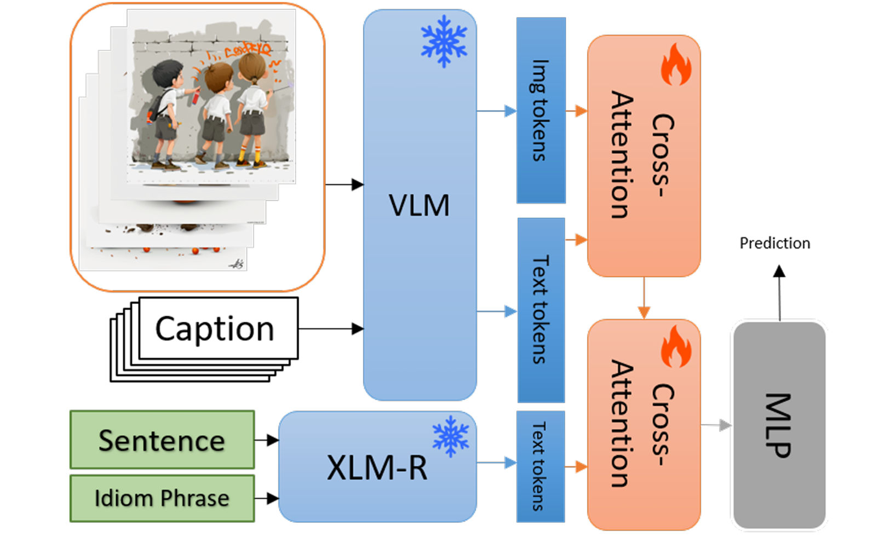

# IMMCAN: Idiom Multimodal Cross-Attention Network

  

Official research code for:

**VisAffect at MWE-2026 AdMIRe 2: IMMCAN Idiom Multimodal Cross-Attention Network**

Barış Bilen, Ali Azmoudeh, Hazım Kemal Ekenel, Hatice Köse

## Overview

We investigate the AdMIRe static image ranking task: an idiomatic or literal
sentence is paired with **five image-caption candidates** to rank by semantic
compatibility. IMMCAN combines a frozen XLM-R idiom encoder with a frozen
Jina CLIP v2 vision-language encoder. Trainable co-attention fuses text/image
token representations; idiom-to-multimodal conditioning then produces a
per-candidate compatibility prediction. The repository also includes
caption-only text baselines (ListNet and ordinal regression).

The paper investigates AdMIRe 1.0 and AdMIRe 2.0 zero-shot evaluation.
This release contains the core training variants and will be extended as
additional checkpoints and evaluation scripts become available.

## Repository structure

~~~text
src/immcan/
  attention.py   - original bidirectional co-attention and idiom fusion blocks
  encoders.py    - frozen XLM-R and Jina CLIP v2 wrappers
  data.py        - dataset, rank targets and batching
  models.py      - multimodal model and text-only ranker
  losses.py      - ListNet and smoothed classification loss
  train.py       - experiment CLI and checkpoint saving
tests/           - offline data/model/loss smoke tests
data/            - dataset directory guide; no data committed
weights/         - weights manifest, download links pending
~~~

The original framework diagram and MIT license are preserved.

## Installation

Tested syntactically against Python 3.10+ style APIs; end-to-end reproduction
requires access to pretrained weights, official data and a compatible GPU.
Jina CLIP v2 uses Transformers trust_remote_code: review the upstream code
before loading it.

~~~bash
git clone https://github.com/AliAZ98/IMMCAN.git
cd IMMCAN
python -m venv .venv
# Activate .venv using your platform's usual method
python -m pip install -e '.[dev]'
python -m pytest -q
~~~

Dependencies are in pyproject.toml. Use a CUDA-matched PyTorch installation
for GPU training. Original versions and model revisions still need to be
confirmed against the authors' experimental environment.

## Prepare datasets and encoders

Obtain the licensed AdMIRe train/dev images and TSV files; see data/README.md.
Each TSV has five image name/caption columns and expected_order ground-truth
ranking. Copy the authors' XLM-R MAGPIE model directory to
weights/xlmr-magpie-seqcls-manual (config, tokenizer and safetensors). Jina
CLIP v2 is downloaded from jinaai/jina-clip-v2 at runtime if accessible.

Large weights, datasets, and local experiment results are gitignored.
Links for the original trained checkpoint files are placeholders in
weights/README.md, pending author-provided URLs and licensing review.

## Train a multimodal model

~~~bash
python -m immcan.train \
  --task multimodal-regression \
  --train-tsv data/EN/train/subtask_a_train.tsv data/PT/train/subtask_a_train.tsv \
  --train-root data/EN/train data/PT/train \
  --dev-tsv data/EN/dev/subtask_a_dev.tsv data/PT/dev/subtask_a_dev.tsv \
  --dev-root data/EN/dev data/PT/dev \
  --idiom-model weights/xlmr-magpie-seqcls-manual \
  --output-dir outputs/multimodal-regression --epochs 100
~~~

Use --task multimodal-classification for the five-rank classifier. The
baseline-compatible visual input is --visual-text sentence; use
--visual-text caption only for a **new, explicitly labeled experiment**.
Both backbones are frozen; attention blocks and MLP heads are trainable.

## Train a text-only baseline

~~~bash
python -m immcan.train \
  --task text-listnet \
  --train-tsv data/EN/train/subtask_a_train.tsv data/PT/train/subtask_a_train.tsv \
  --train-root data/EN/train data/PT/train \
  --dev-tsv data/EN/dev/subtask_a_dev.tsv data/PT/dev/subtask_a_dev.tsv \
  --dev-root data/EN/dev data/PT/dev \
  --idiom-model weights/xlmr-magpie-seqcls-manual \
  --output-dir outputs/text-listnet --epochs 200
~~~

Use --task text-regression for SmoothL1 ordinal rank regression.
The text-only model consumes candidate captions, not the pixels themselves.
For augmented training, pass each augmented TSV AND its matching original
image root. The loader refuses mismatched lists.

## Evaluation and checkpoints

Training reports loss and top-1 image accuracy per five-candidate example.
The candidate order follows the image1..image5 columns and does **not**
place the correct candidate at index zero. This fixes an optimistic metric
artifact found in the source scripts. The CLI saves best-by-loss and
best-by-top1 fusion checkpoints to outputs/. These **are not necessarily
binary-compatible with the legacy paper checkpoints**.

The automated tests cover offline shapes, basic gradients, data integrity,
and ranking losses. Full official benchmark reproduction requires the
corresponding author-supplied checkpoints and evaluation scripts.

## Citation

~~~bibtex
@inproceedings{bilen2026visaffect,
  title={VisAffect at MWE-2026 AdMIRe 2: IMMCAN Idiom Multimodal Cross-Attention Network},
  author={Bilen, Baris and Azmoudeh, Ali and Ekenel, Hazim Kemal and Kose, Hatice},
  booktitle={Proceedings of the 22nd Workshop on Multiword Expressions (MWE 2026)},
  pages={149--153},
  year={2026}
}
~~~

## License

MIT; see LICENSE. Dataset and model redistribution are subject to the
respective external licenses and permissions.
